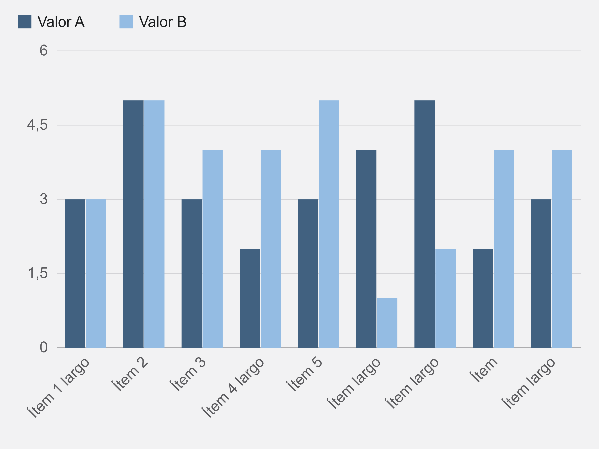
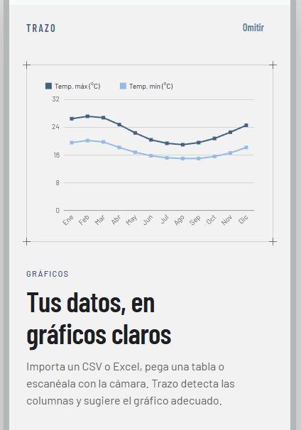
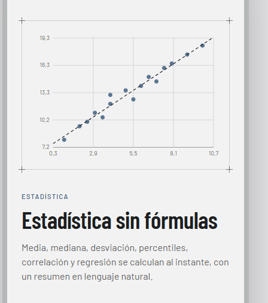
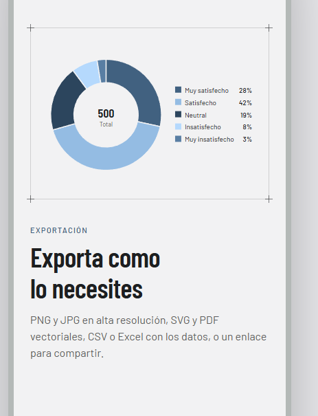

# Trazo

Demo de una Aplicación web ligera (*standalone*) para transformar datos en gráficos claros, calcular estadística descriptiva al instante y exportar visualizaciones listas para publicación o impresión.

## Demo en vivo
[Abrir Trazo App](https://paolaandreapanozo70-spec.github.io/Trazo_app/)

## Vista previa de la interfaz

| Gráficos | Estadística | Exportación |
| :---: | :---: | :---: |
|  |  |  |
## Características principales

### Importación flexible de datos
- **Archivos:** Soporte para `.csv`, `.tsv`, `.txt`, `.xlsx`, `.xls` y `.ods`.
- **Pegar directo:** Copia filas desde hojas de cálculo, PDF o páginas web.
- **Escaneo (OCR):** Fotografía una tabla impresa con la cámara para convertirla en datos editables.
- **Entrada manual:** Crea y edita tablas desde cero.
- **Detección inteligente:** Identifica columnas automáticamente y sugiere el gráfico adecuado.

### Visualizaciones y plantillas
Incluye plantillas con datos de ejemplo listos para reemplazar:
- **Evaluación comparativa:** Gráficos de mancuernas (*dumbbell*) y barras agrupadas.
- **Series temporales:** Gráficos de líneas para evolución de variables.
- **Regresión lineal:** Gráficos de dispersión con línea de tendencia.
- **Distribución:** Histogramas de frecuencias y calificaciones.
- **Encuestas:** Gráficos de dona con proporciones y totales.
- **Mapas regionales:** Mapas de celdas (*tile grid maps*) por país o región.

### Estadística sin fórmulas
- Cálculo instantáneo de media, mediana, desviación estándar, percentiles, correlación y regresión.
- Resumen automático de los resultados en lenguaje natural.

### Exportación profesional
- **Imágenes en alta resolución:** PNG y JPG (`@4x`).
- **Formatos vectoriales:** SVG y PDF listos para edición o imprenta.
- **Datos y colaboración:** Exportación en CSV, Excel o mediante enlace para compartir.

## Uso local
No requiere instalación ni dependencias externas. Descarga `index.html` y ábrelo en cualquier navegador moderno.

## Licencia
Distribuido bajo la licencia MIT
